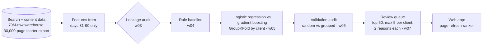
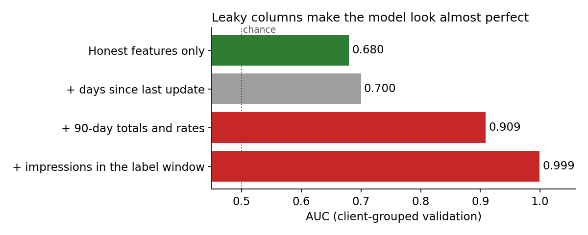
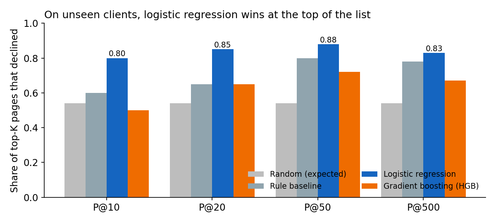

# Search Ranking & Discoverability

**Which pages should a content reviewer look at first, when there are far more pages than anyone can review?**

My work from the FlyRank AI machine learning internship (Jul–Sep 2026). The repository started from the programme's template; everything in `work/` and this write-up are mine.

---

## Result in one line

On clients the model had never seen, a logistic regression ranked pages so that **44 of its top 50 were observed to decline** (Precision@50 = 0.88), against 0.80 for my rule-based baseline and a 0.54 base rate.

## The pipeline at a glance



The middle boxes are notebooks in `work/notebooks/`. Read left to right: what the data is, which columns are allowed, what the simplest rule achieves, which model beats it on clients it never saw, and how the scores become a list a person can work through. The last step is a separate repo, [page-refresh-ranker](https://github.com/RodionOm/page-refresh-ranker), which serves the same model behind a FastAPI app.

---

## The problem

A content team can review a few dozen pages a week; the sites have tens of thousands. So the question is not "will this page perform well" but **"which pages deserve a human's limited attention first?"** That makes it a ranking problem under a capacity limit:

- **Unit:** one content page.
- **Label:** did the page's search impressions go down in the last 30 days compared with the 30 days before? (54.2% of pages did.)
- **Metric:** Precision@K, the share of the top K pages that actually declined. Reviewers only work down the top of the list, so accuracy over all 30,000 pages would measure the wrong thing.

---

## What I did

| Step | Notebook | What it does |
| --- | --- | --- |
| Research question | `w01_research_question` | Framed refresh review as decision support under limited capacity |
| ML task framing | `w02_ml_task_framing` | Binary classification used as a ranking; Precision@K as the metric |
| Data contract | `w03_data_contract` | Checked the warehouse grain (9.8M page-day rows in March 2026), feature / label / excluded fields, a deliberate leakage trap |
| Leakage check | `w03_feature_leakage_check` | 23 leakage-safe features from the windows *before* the label period |
| Baseline | `w04_baseline_score` | A transparent hand-written rule to beat |
| Model | `w05_model` | Logistic regression and gradient boosting, out-of-fold, grouped by client |
| Validation audit | `w06_validation_audit` | Random vs client split, leakage trap test |
| Action playbook | `w07_action_playbook` | A review queue with reason codes, limits, monitoring |

`w04_signal_audit` (optional) and `capstone` are not completed.

---

## What the evaluation checks

Each row is a rule I held the analysis to, where it is done, and the evidence in the saved output.

| Rule | Where | Evidence |
|---|---|---|
| Features come only from before the prediction point | `w03_feature_leakage_check`: 23 features from days 31–90 | trap test below: adding label-window impressions sends AUC to 0.999 |
| A model is scored only on clients it never saw | `w05_model`: `GroupKFold` by client, out-of-fold scores | random KFold overstates gradient boosting: AUC 0.792 vs 0.698 grouped (`w06_validation_audit`) |
| Judge the top of the list, not the whole ranking | `w05_model`: Precision@10/20/50/500 next to AUC | HGB has the best AUC (0.698) but a worse P@50 (0.72 vs 0.88) |
| Beat a transparent rule before trusting a model | `w04_baseline_score` | rule P@50 0.80 vs logistic regression 0.88 |
| One client cannot fill the queue | `w07_action_playbook`: at most 5 pages per client | 46 of the top 50 declined, across 14 clients |
| Every queued page says why | `w07_action_playbook`: weight × standardised value, top 2 | reason codes per row, with how often each appears |
| Say where the model is weak | `w06_validation_audit` | mid-traffic pages AUC 0.57–0.59 (see Limits) |

## Leakage: the most important finding

The label compares the last 30 days with the previous 30. Any 90-day total contains the last 30 days, so it already holds the answer.

```
|---- older 30 days ----|---- previous 30 days ----|---- last 30 days ----|
       feature ✓                  feature ✓               label window ✗
|<------------------------ 90-day totals ✗ ------------------------------->|
                                                   ^ prediction point
```

| Feature set | AUC |
| --- | --- |
| Honest features only | 0.680 |
| + impressions in the label window | 0.999 |
| + 90-day totals and rates | 0.909 |

Only data from before the prediction point is used.



The two red bars are the trap: a model that sees the label window, or 90-day totals that overlap it, looks close to perfect but would be useless at the moment a reviewer needs the list.

---

## Results (5-fold GroupKFold by client, out-of-fold)

Every page is scored by a model that never saw its client.

| Method | P@10 | P@20 | P@50 | P@500 | AUC |
| --- | --- | --- | --- | --- | --- |
| Random (expected) | 0.54 | 0.54 | 0.54 | 0.54 | 0.500 |
| Baseline rule | 0.60 | 0.65 | 0.80 | 0.78 | 0.650 |
| **Logistic regression** | **0.80** | **0.85** | **0.88** | **0.83** | 0.673 |
| Gradient boosting (HGB) | 0.50 | 0.65 | 0.72 | 0.67 | 0.698 |



Gradient boosting has the best AUC but a worse top of the list, which is what reviewers use. Logistic regression wins where it matters and gives readable reasons.

### Why the split matters

| Split | Model | P@500 | AUC |
| --- | --- | --- | --- |
| Random KFold (same client in train and test) | gradient boosting | 0.93 | 0.792 |
| **GroupKFold by client** | gradient boosting | **0.67** | 0.698 |
| Random KFold | logistic regression | 0.87 | 0.726 |
| **GroupKFold by client** | logistic regression | **0.83** | 0.673 |

A random split lets gradient boosting memorise clients; on unseen clients its top 500 drops from 0.93 to 0.67. Logistic regression is too simple to memorise a client, so it holds up.

### Trap test

Adding a leaky column on purpose sends AUC to 1.0, which shows the evaluation catches leakage. The honest 23 features have no column from the label window.

---

## The review queue

`w07_action_playbook` turns the scores into a queue a human can use:

- Top 50 pages, **at most 5 per client**: 46 of 50 declined, 14 clients covered.
- Two plain-English **reason codes** per page, from the logistic regression's weights (weight × how far the page is from average).
- Confidence bands checked against outcomes: low 0.35, medium 0.59, high 0.69 observed decline rate.
- Review flags: 19 of 50 queued pages need an extra check (spike-driven, short history, no keyword data).

---

## Limits (stated openly)

- **Mid-traffic pages:** AUC only 0.57–0.59; ranking there is close to chance.
- **One snapshot:** a single 30-day label period; no time-based split across months.
- **Not causal:** a high score means similar pages declined, not that a refresh will stop the decline.
- **Decision support:** a short list for a reviewer, not a traffic forecast.

---

## Run it

Each notebook opens in Colab and clones the starter data itself. Locally:

```bash
pip install -r requirements.txt
jupyter lab work/notebooks/
```

`data/raw/` holds the anonymised starter dataset from the programme; warehouse notebooks need a Hugging Face token kept in Colab secrets.

---

*Part of the FlyRank AI ML internship. Code MIT (`LICENSE`); data terms in `DATA_USE.md`. Results are observed and directional decision-support, not a claim about how any search engine ranks pages.*
